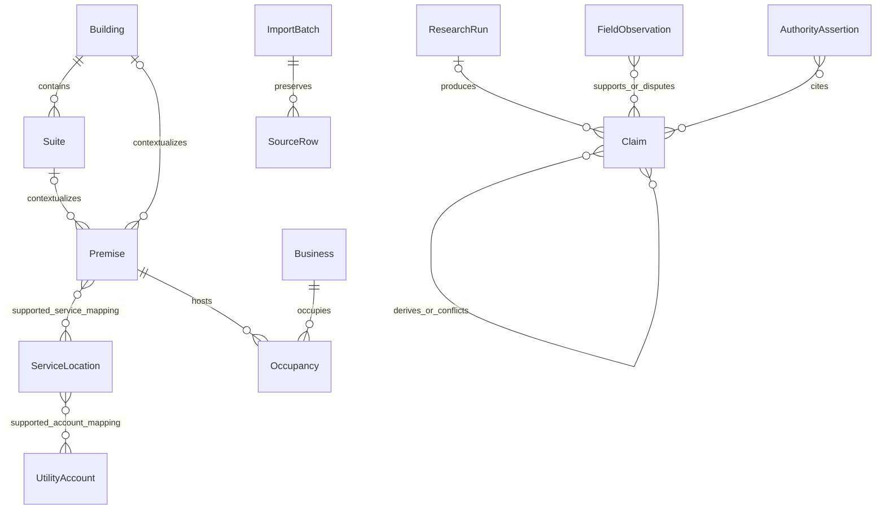

# FieldMind entity model — Stage B1 amendments

Architectural foundation approved after Stage A; amendments implemented as persistence-free contracts and functions in B1. No migration, storage replacement, app integration or deployment is included. FieldMind remains precontact opportunity intelligence.

## Identity and physical location

Internal IDs are opaque workspace-scoped identities, generated by a future trusted boundary (UUID recommended). Synthetic fixtures use readable labels. Never derive identity from an address, name or account number. Exact external identifiers preserve leading zeros, punctuation, issuer/provider and type. Even an exact external-reference match returns review candidates, never an accepted merge.

- **Building:** a physical structure. Its address is not a suite, premise or meter identifier.
- **Suite:** a labeled subdivision within one known building. Identical labels in different buildings remain different suites. Missing suite information stays unknown.
- **Premise:** the operational location being researched. May reference a known building and suite; a suite requires its matching building. A premise with no suite reference does not imply the whole building.
- **Utility service location:** the provider's service point/reference, distinct from occupied space. It can serve multiple explicitly linked premises; multiple service points can serve one premise. Unknown mapping is an empty linkage list, not a fabricated premise.
- **Utility account:** a provider-scoped account reference, distinct from both service point and account holder. Accounts may link to multiple supported service locations. Multiple accounts can coexist; dates do not establish sequential succession.

A **Business** has names/aliases and external references, not intrinsic location or decision rights. **Occupancy** links a Business to a Premise with supported, possibly unknown temporal bounds. Overlapping occupancies are permitted: overlap alone cannot justify a merge or deletion. **Party** is a minimal person/organization identity for an authority assertion, not a CRM contact pipeline.

Service and occupancy links must cite matching relationship claims. Their presence is a recorded assertion, not proof that it is current or verified; consumers must evaluate linked claims. No address-based linkage operation exists.

## Auditable records

Executable contracts are exported from [`domain/contracts.mjs`](../domain/contracts.mjs). `schemaVersion: 1` is the new **domain snapshot** version; it is not the existing research JSON v2 or legacy backup version. All collection arrays are explicit. Every record has `id`, `workspaceId`, `createdAt`. Records are append-only through this API; no revision/update/delete or persistence API is introduced. Future storage revisions belong to the repository boundary.

| Record | Contract summary |
|---|---|
| Building / Suite / Premise | Exact original address; typed external refs with SourceRow provenance; suite/building references remain explicit |
| ServiceLocation | Nullable provider and external reference, explicit `premiseIds`, relationship-support Claim IDs |
| Business / Party | Business names and aliases; minimal named person/organization/unknown identity |
| Occupancy | Business ID, Premise ID, period, supporting relationship Claims |
| UtilityAccount | Exact reference, nullable provider, `serviceLocationIds`, period, supporting Claims; unknown provider prevents identity assumptions |
| ImportBatch | Exact raw text including quoting/newlines, filename, declared source/list type, importer identity, parser/mapping versions |
| SourceRow | Immutable batch ID, row index, ordered headers and cells (including duplicate headers, empty values and original formatting) |
| Claim | Typed subject, predicate/value, origin, basis, review state, temporal scope, period, source publication/observation dates, citations/rows/observations, dependencies/conflicts and optional ResearchRun |
| ResearchRun | Exact request/response text, protocol version, requested premise IDs, completion time and found/not-found/not-checked coverage |
| FieldObservation | Representative actor, exact subject/predicate/value, direct observation / staff statement / inference / record review, note and observation time |
| AuthorityAssertion | One authority kind, exact subject, nullable holder, matching supporting Claims |
| ListMembership | Exact subject, SourceRow and list type; multiple memberships coexist |
| ProspectAuthorization | Manager issuer, exact subject, SourceRow, authorize/withdraw decision, reason/time |
| Suppression | Manager issuer, exact scope, SourceRow, reason/time; no implicit expiry |
| SuppressionRelease | Separate manager event referencing one suppression, source row, reason/time; original suppression retained |

Unknown source fields remain in raw input; strict normalized records reject undeclared fields instead of silently dropping them. Invalid parsed row widths do not discard the ImportBatch raw text; a future importer must quarantine the malformed row before any domain append.

## Five independent authority concepts

| Authority kind | Subject | Never inferred automatically from |
|---|---|---|
| Business ownership | Business | On-site manager, listed account name, property owner |
| Business operations | Occupancy | Business ownership or an employee's presence |
| Utility-account authority | UtilityAccount | Business ownership, occupancy, or account reference possession |
| Property authority | Building / Suite / Premise | Business owner or utility account holder |
| HVAC/facilities authority | Building / Suite / Premise / ServiceLocation | Property ownership, occupancy, historic thermostat participation |

Holder is a Party or Business backed by Claims matching exact subject, authority kind and holder ID. Resolve each concept independently with `authorityFor()`:

- **verified:** supported by matching direct observation or representative record review, with actor, exact value and timestamp.
- **inferred:** explicit inference with supported Claim dependencies; never promoted to verified.
- **disputed:** disputed dependency, explicit conflicting claim or competing supported holders. Return no selected holder.
- **unknown:** no usable current support, missing holder, unreviewed reports, historical-only support or stale evidence. Retain evidence IDs for inspection.

Public records and other sources retain their origin, excerpt, scope and dates. A retrieved source does not become representative verification just because AI labels it verified. A representative may record a review of an authoritative record; the review is distinct from on-site observation. Staff statements remain statements. Unknown authority does not mean the source was not found: source coverage, documentary findings and authority verification are different concepts.

## Evidence and temporal semantics

`origin` distinguishes public_record, public_source, manager_list, ai and field; `basis` distinguishes reported, observed and inferred. Review is unreviewed, verified, disputed or superseded. Temporal scope is historical, as_of or unknown. Verification requires a supporting FieldObservation matching subject, predicate and exact value, and no inference basis. An older observation cannot verify a later claim observation.

Every Claim needs a citation, SourceRow, FieldObservation or dependency. Inferences require dependencies; missing/cyclic dependencies reject the snapshot. Citations require HTTP(S), excerpt, title, retrieval time and exact subject scope. Building-level evidence can support an explicit inference about a suite via dependencies, never a directly scoped suite fact without evidence. Explicit conflicts apply in both directions at evaluation even if only one claim lists the other; conflicts must concern the same subject and predicate.

Resolvers require an explicit `asOf` date. Default freshness is conservative: same-day support only (`maxAgeDays: 0`). A caller must explicitly supply a reviewed freshness window to broaden it. Future/historical/superseded/unknown-date support does not become current authority. Unknown period endpoints remain unknown, not proof of continuity. Freshness policy by claim type is not yet approved.

## Manager control plane, independently auditable

List membership, manager prospect authorization, suppression/release and research claims are separate collections with separate provenance. Research predicates cannot write approval, eligibility, suppression or membership. AI caller permissions restrict appends to unreviewed AI Claims and ResearchRuns. Manager directives require an issuing manager; observations require the observing representative. Trusted actor identity/roles come from the future authenticated boundary, never the research payload.

`prospectDecision()` requires explicit subject scopes. It returns authorization IDs, suppression/release IDs, memberships and `eligibility: not_established`. Approval does not establish eligibility. Suppression blocks the precontact research recommendation even when approval exists; a generic Active row cannot remove DNC. Conflicting equal-time directives are disputed; withdrawal wins conservatively across requested scopes. Only a separately recorded manager release clears its specifically referenced suppression, as of the requested time. Scope propagation is intentionally not inferred; uncertain scope must be reviewed before use.

## Historical MIMO

`historical_participation` and `historical_equipment` are historical Claims scoped to the relevant UtilityAccount. Preserve all source rows, account references and dates; unknown dates stay null. `mimoHistory()` always reports current equipment unknown, current eligibility not established and account sequence not inferred. Prior devices, participation and account date overlap never establish present installation, compatibility, authority or eligibility.

## Trust and implementation limits

This is an in-memory domain boundary. It validates caller-supplied trusted actor context but cannot authenticate anyone, verify the truth of an excerpt or enforce storage access. No API in B1 transforms or migrates legacy data. Storage constraints, durable event signatures, scale limits, authenticated scope enforcement and user review screens remain future work requiring approval.
