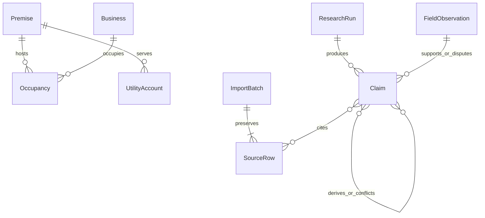

# Proposed entity model — review required, not implemented

FieldMind provides precontact opportunity intelligence. This model supports evidence-backed decisions, not a CRM pipeline, routing engine, enrollment system, or live sales scripts.

All internal IDs are opaque generated UUIDs, stable across import and external-ID changes. Every record is workspace-scoped. External IDs remain exact strings (leading zeros and punctuation preserved), with an explicit type, issuer/provider and provenance. Neither names nor normalized addresses are unique business keys. Normalization generates candidates only.

## Relationships

UtilityAccount-to-Premise is a proposed accepted relationship, not inferred from account dates. Unresolved references stay in SourceRows and review candidates until approved. An account may have unknown premise or holder; multiple accounts may serve one premise concurrently. Business, Occupancy and UtilityAccount holder relationships are evidence-backed claims; do not assume the occupant is the account holder or authorized decision-maker.

## Entity contracts

All entities carry `id`, `workspaceId`, `createdAt`, `revision`. Foreign keys must resolve within the same workspace. Deletion policy in the first migration is retain/archive, never cascade-delete source history.

| Entity | Required data and meaning | Constraints / uncertainty |
|---|---|---|
| Premise | Structured service address: line, suite/unit, city, region, postal code, country; exact original address; optional typed external premise references | A service location, not the whole building by default. Missing suite remains unknown. Optional parentPremiseId links a unit to a building without merging them. No unique address constraint. |
| Business | Names and aliases with provenance; optional legal identifiers | Legal entity, trading name and branch are distinct concepts. A chain name does not identify one operator. Unknown operator stays unresolved. |
| Occupancy | premiseId, businessId, optional start/end, date precision and supporting claim IDs | Business-at-location relationship. Open dates mean unknown boundary, not confirmed continuity. Multiple occupancies may coexist; overlap is a review signal, not an automatic rejection. |
| UtilityAccount | Exact account reference, issuer/provider, commodity/service type when known; accepted premiseId if established | Unique identity requires provider plus identifier semantics; otherwise create unresolved reference, not global deduplication. Optional equipment/holder associations need evidence. Do not infer chronology from multiple accounts. |
| ImportBatch | File digest, original filename, import time, list type, declared source/authority, parser and mapping versions, mapping, import/review status | Import time is not source effective time. Store upload events even for duplicate files; repeated identical content must not duplicate accepted assertions. Distinguish declared approval from verified authority. |
| SourceRow | batchId, row index, original ordered headers/cells, row digest, parsed assertions, parse warnings | Immutable. Preserve duplicate headers and all raw values. Derived mappings and linkage decisions are versioned separately; never replace an old row with a new import. |
| Claim | Typed subject reference, predicate, value, provenance, observation time, effective time/precision, scope, epistemic and review state | Subject must identify Premise, Business, Occupancy or UtilityAccount. Equipment claims include equipment reference and historical scope. Source requirements below apply. Unknown dates stay null; source publish date, effective date and retrieval date remain separate. |
| ResearchRun | Request/response digests, requested premise refs, protocol/schema version, tool/model metadata when available, start/completion times, sources checked, coverage and validation outcome | Immutable accepted run. Rejected/quarantined responses retain diagnostics. A summary is a projection of linked claims, never independent proof. |
| FieldObservation | Observer identity, premise/occupancy context, observedAt, recordedAt, observation type, exact note, claim links, optional structured answers | Distinguish direct observation, staff statement and representative inference. Verification records actor, time, scope and basis. Amend by a new observation, retaining original. |

## Claim dimensions: avoid one overloaded confidence status

- **Origin:** public source / authorized list / AI synthesis / representative observation.
- **Basis:** reported fact / direct observation / inference. Public records establish only what that record actually covers.
- **Review:** unreviewed / confirmed by representative / disputed / unresolved conflict / superseded.
- **Temporal scope:** historical / current as of date / unknown. Freshness is a derived policy per claim type.
- **Support:** source citations (URL, title, retrieval time, excerpt, scope), SourceRow IDs, FieldObservation IDs or supporting Claim IDs.

`not_checked` and `not_found` describe research coverage, not negative facts. AI import cannot confer representative verification. An authoritative record may establish a permit for a building without establishing current suite equipment. Thermostat estimates remain inferences with assumptions, never counts or eligibility proofs.

Polymorphic subjects must be enforced using typed nullable foreign keys with exactly-one-subject checks, or equivalent validated relational links. Use join tables for claim citations, dependencies and conflicts. Missing evidence references block established conclusions. Derived conclusions must retain all dependency IDs; a disputed or superseded dependency triggers recomputation/review. Never silently promote an inference to verified fact.

## Historical MIMO and suppression

MIMO is a list assertion about historical participation, not a present occupant/equipment qualification. Keep list membership per batch/row; approved and MIMO memberships can coexist. Historical equipment claims attach to the supported account/occupancy period, with unknown ownership and dates explicit.

Suppression assertions retain source, scope, effective period and authority. A later generic `Active` row cannot erase a prior DNC/hold. Resolution requires explicit authorized policy and a recorded decision. If suppression scope is ambiguous, flag/restrict pending review; research cannot approve, unsuppress or establish enrollment eligibility.

## Identity review rules

Exact, issuer-scoped premise references may support deterministic linkage only after verifying identifier semantics. An address, name, hash, shared device or account reference alone is insufficient for an automatic merge. Account continuity and occupancy continuity are separate questions. Ambiguous candidates produce a review record containing alternatives, evidence and reason; leave raw records intact.

## Approval decisions

Approve or amend: premise granularity (service location/unit with optional building parent); provider-scoped account identity; nullable temporal boundaries; explicit account-holder uncertainty; immutable source rows; separate assertion/review/temporal states; conservative suppression policy. These are design proposals only. No schema or migration is executed in Stage A.
